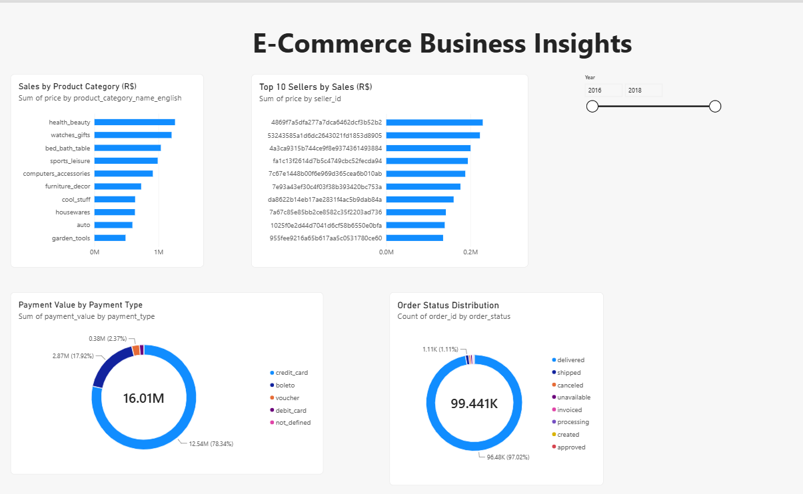

# E-Commerce Business Intelligence & Decision Analytics Platform

An end-to-end e-commerce analytics project using **SQL, Power BI, and Excel** to analyze business performance, customer activity, product categories, seller performance, payment trends, and customer reviews.

## Project Overview

This project analyzes e-commerce data to identify business trends, monitor key performance indicators, and support data-driven decision-making through SQL analysis, interactive Power BI dashboards, and Excel reporting.

## Tools & Technologies

- **SQL (SQLite):** Data validation, joins, aggregations, duplicate checks, and business metrics
- **Power BI:** Interactive dashboards, KPI cards, trend analysis, and slicers
- **Microsoft Excel:** Business summary and key metric reporting

## Dataset

The project uses the [Brazilian E-Commerce Public Dataset on Kaggle](https://www.kaggle.com/datasets/olistbr/brazilian-ecommerce). It includes data about customers, orders, order items, payments, reviews, products, sellers, geolocation, and product-category translations.

## Key Business Metrics

| Metric | Value |
|---|---:|
| Total Orders | 99,441 |
| Unique Customers | 96,096 |
| Order Items | 112,650 |
| Payment Records | 103,886 |
| Review Records | 99,224 |
| Total Payment Value | R$16,008,872.12 |

## Power BI Dashboards

### 1. E-Commerce Overview Dashboard


This dashboard includes:
- Total orders and unique customers
- Total payment value
- Monthly order trends
- Monthly payment trends
- Year and order-status filters

### 2. E-Commerce Business Insights Dashboard



This dashboard includes:
- Sales by product category
- Top 10 sellers by sales
- Order-status distribution
- Payment value by payment type
- Year filter

## SQL Analysis & Validation

The SQL validation script includes:
- Row-count checks across nine tables
- NULL checks for important ID columns
- Duplicate key checks
- Foreign-key and orphan-record checks
- Core business metric calculations
- Payment value analysis
- Review-score distribution and data-quality checks
- Order-status distribution

## Excel Reporting

The Excel workbook provides a summary of key e-commerce metrics for quick business reference.

## Data Quality Notes

- The dataset contains 99,224 review rows and 98,410 distinct review IDs.
- Repeated review IDs were investigated. No fully identical rows were found across the seven review columns checked.
- Repeated review IDs were not automatically deleted.
- Total payment value represents recorded payments, **not profit**. Profit cannot be calculated accurately without complete cost data.

## Repository Structure

```text
ecommerce-business-intelligence/
├── README.md
├── ecommerce_analysis.sql
├── E-commerce_Business_Summary.xlsx
├── Ecommerce_Business_Intelligence.pbix
├── ecommerce_overview_dashboard.png
└── business_insights_dashboard.png
```

## Conclusion

This project demonstrates practical SQL data validation, e-commerce business metric analysis, interactive Power BI reporting, and Excel-based business summaries for decision support.
